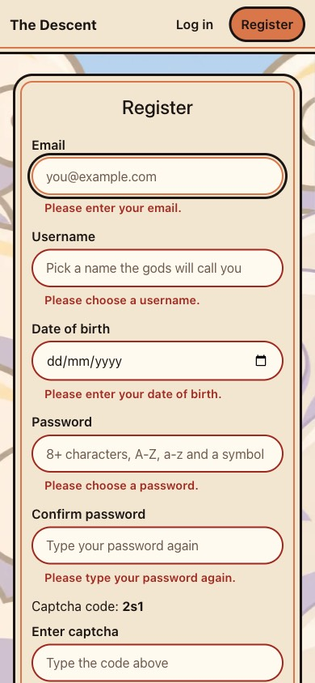
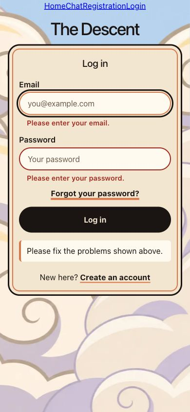
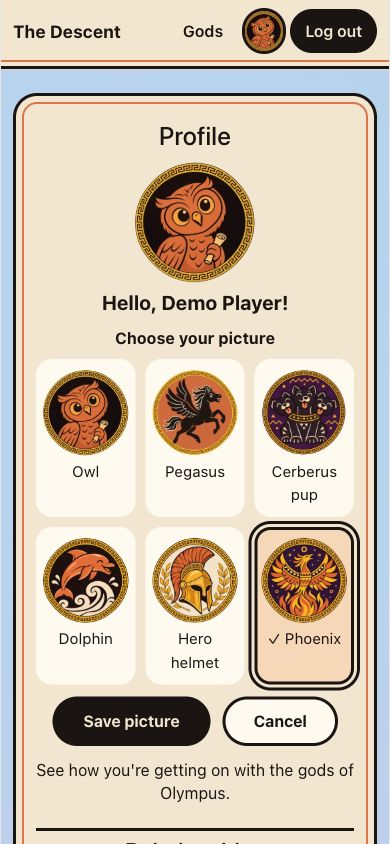
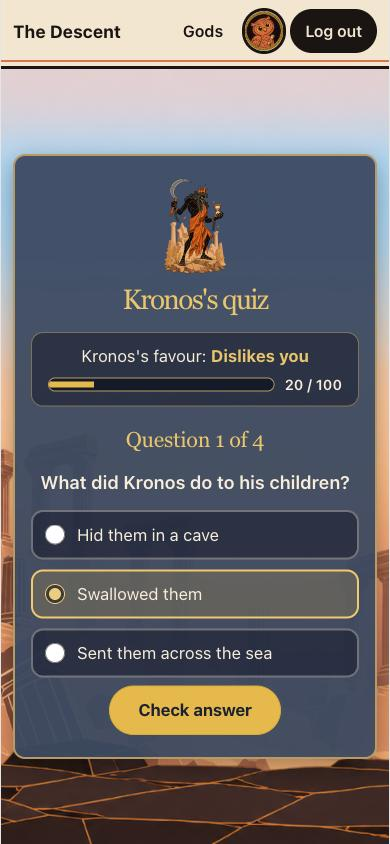
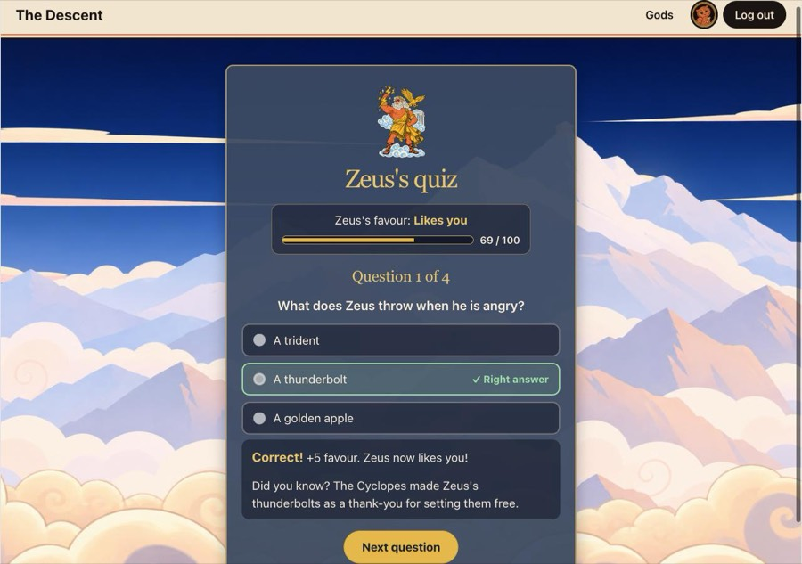
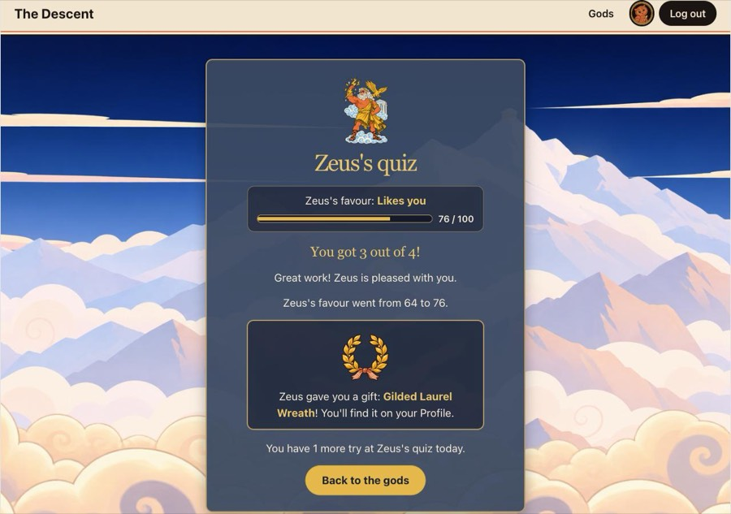

# Testing log: George's pages

This is a record of how we check that George's pages do what our requirements say. It
will cover the **Registration, Log in, Forgot password, Reset password, Navbar, Homepage
and Profile** pages, added one page (or a few small ones) at a time.

Each test says which requirement it checks (the FE / NFR numbers from
`Frontend_requirements.docx`), what we did, what should happen and what actually happened.

## How we test

- **Automated browser tests:** every test is run by a script that opens Chrome and
  clicks, types and checks the result the same way a person would. That makes the tests
  quick to repeat after every change.
- **Checked by hand:** the most important tests are also done by hand by George, in a
  normal browser window. The "By hand" column shows which ones.
- **Phone size first:** tests use a phone-sized window (390 × 844) unless they say
  otherwise, because most of our players will be on phones.
- **Front end only:** these tests check what the pages do in the browser. Testing the
  server and the database themselves is not part of this log.

**Key:** ✅ passed · ❌ failed · ⚠️ found a problem somewhere else

---

## Summary

| Page | Date tested | Version tested | Tests | Passed | Problems found |
|---|---|---|---|---|---|
| Registration | 22 November 2026 | `feature/profile`, commit `9d9b81d` | 19 | 19 | None |
| Log in | 27 November 2026 | `main`, commit `3259205` | 12 | 12 | None |
| Forgot password | 27 November 2026 | `main`, commit `3259205` | 5 | 4 | 1 (see F3) |
| Reset password | 27 November 2026 | `main`, commit `3259205` | 5 | 5 | None |
| Navbar | 27 November 2026 | `feature/profile-pictures`, commit `f7fdb03` | 6 | 6 | None |
| Homepage | 27 November 2026 | `feature/profile-pictures`, commit `f7fdb03` | 7 | 7 | None |
| Profile | 27 November 2026 | `feature/profile-pictures`, commit `f7fdb03` | 13 | 13 | None |
| Profile pictures | 27 November 2026 | `feature/profile-pictures`, commit `f7fdb03` | 8 | 8 | None |
| Quiz | 27 November 2026 | `feature/profile-pictures`, commit `f7fdb03` | 22 | 22 | None |

Registration was tested on the branch where all of George's pages are joined together
with Nora's god selection and chat, so everything was tested working together. From
24 November we test `main`, because the Log in pages have now been merged into it.
The navbar, the homepage, the Profile page and the quiz aren't in `main` yet (it still has the old
row of links and an empty Home page), so on 27 November they were tested on
`feature/profile-pictures`, the branch where they sit together with Nora's gods page, the
quiz and profile pictures.

---

## Before you start: the pretend server

The backend isn't finished yet, so the pages use a **pretend server** that answers like
the real one would. That means we can test every kind of reply, including the error ones,
by using these special test details:

| Page | Type this | What happens |
|---|---|---|
| Registration | Email `taken@example.com` | Says the email already has an account |
| Registration | Email `offline@example.com` | Acts like the server is down |
| Registration | Any captcha except `2s1` | Says the captcha is wrong |
| Log in | Email `wrong@example.com` | The test script answers "no match" |
| Forgot password | Email `unknown@example.com` | The test script answers "no account with that email" |
| Log in, Forgot password | Email `offline@example.com` | The test script acts like the server is down |
| Reset password | Address ending `?token=expired` | Says the link has expired |
| Reset password | Address ending `?token=offline` | Acts like the server is down |
| Log in (on `feature/profile-pictures`) | Any email and password | Logs in as "Demo Player" |
| Profile | Address ending `?test=offline` / `?test=junk` / `?test=new` | Server down / a broken reply / a brand new player |
| Profile pictures | Saving while the address ends `?test=offline` / `?test=junk` | Server down / a broken reply |
| Quiz | Address ending `?test=offline` / `?test=junk` | Server down / a broken reply |
| Quiz | Hermes's quiz | Starts with both of today's tries used, to show "Come back tomorrow" |
| Quiz | "Reset for demo" (under "Come back tomorrow") | Gives that god's 2 tries back. Only there while the pretend server is on |

Anything else counts as "it worked". **These tests will need doing again once the real
server is connected.**

**Log in and Forgot password (from 23 November):** these two pages are now connected to
the team's server code, so they no longer have a pretend server built in. To test just
the pages, the test script answers in the server's place, with the same kind of reply
the real server sends. Reset password still has its pretend server.

---

## Registration (`/registration`)

**Tested:** 22 November 2026

| ID | What we checked | What we did | What should happen | What happened | Result | By hand |
|---|---|---|---|---|---|---|
| R1 | FE-01: there is a sign-up form. Accessibility: every box has a label | Opened the page | Email, Username, Date of birth, Password, Confirm password, Captcha and the Terms tick box, each with its own label. Passwords hidden | All 7 there, all labelled, passwords hidden as dots, date box opens a date picker | ✅ | |
| R2 | FE-03: clear message when sign-up fails | Clicked Register with everything empty | A message under every box, "Please fix the problems shown above", and the cursor jumps to the first problem | All 7 messages shown (for example "Please enter your email."), cursor moved to Email | ✅ | ✅ 22 Nov |
| R3 | FE-03: email check | Typed `hermes.example.com` (no @) | "That doesn't look like an email..." | Exactly that | ✅ | |
| R4 | FE-03: username rules | Tried `Zeus King` (has a space) and `Ze` (too short) | "Use only letters, numbers and _" and "needs 3 to 20 characters" | Both messages shown | ✅ | |
| R5 | FE-03: password rules | Tried passwords that were too short, had no capital, no small letter, no symbol | A different message for each one | "at least 8 characters", "Add at least one capital letter", "...small letter", "...symbol" | ✅ | |
| R6 | FE-03: passwords match | Typed two different passwords | "The passwords don't match." | Exactly that | ✅ | |
| R7 | Minimum age 13 (team decision) | Tried a date next year, a date in 1899, someone who is 12, and someone who turns 13 today | Future date, very old date and age 12 are stopped. Age 13 is allowed | "That date is in the future", "Please check the year you were born", "Sorry, you need to be 13 or older to join The Descent." Age 13 was accepted | ✅ | |
| R8 | Terms must be ticked | Left the Terms box empty | "Please tick the box to agree before you register." | Exactly that | ✅ | |
| R9 | Registration flowchart: wrong captcha | Typed the captcha `abc` | "That code isn't right", cursor goes back to the captcha box | Both happened | ✅ | |
| R10 | Registration flowchart: email already used | Used `taken@example.com` | "That email already has an account. Try logging in instead." | Exactly that | ✅ | ✅ 22 Nov |
| R11 | NFR-06: server down | Used `offline@example.com` | A friendly message, never a blank page, and the form keeps what you typed | "We can't reach the server right now..." and nothing was lost | ✅ | ✅ 22 Nov |
| R12 | NFR-09: button feedback while sending | Clicked Register and looked at the button straight away | The button says "Registering..." and can't be clicked twice | Both true | ✅ | |
| R13 | Registration flowchart + FE-06: success | Filled everything in correctly | The clouds open, "Welcome, Hermes_1!", then the gods page, and the navbar shows you're logged in | All of that. The gods page opened 4.1 seconds after clicking (1 second for the server, 3 for the clouds) | ✅ | ✅ 22 Nov |
| R14 | NFR-14: passwords never saved in the browser | Looked in the browser's storage after signing up | Empty | Completely empty | ✅ | |
| R15 | NFR-03: works with just a keyboard | Used only Tab, Space and Enter | Tab visits every box in order, Space ticks the Terms box | Email → Username → Date of birth → Password → Confirm → Captcha → Terms → Register. Space ticks the box | ✅ | ✅ 22 Nov |
| R16 | NFR-03: you can see where you are | Tabbed into a box | A clear outline around it | A thick 3px outline | ✅ | |
| R17 | NFR-01: phones to big screens | Checked at 360, 768, 1440 and 1920 pixels wide | No sideways scrolling | None at any size | ✅ | |
| R18 | NFR-04: "reduce motion" | Turned on "reduce motion" and signed up | No cloud animation, and the next page comes sooner | The clouds just disappear, and the gods page opened 2 seconds after clicking instead of 4 | ✅ | ✅ 22 Nov |
| R19 | Getting around | Clicked "Already have an account? Log in" | Goes to Log in | It did | ✅ | |

**A note on R13 and R15:** both failed the first time we ran them. Neither was a bug in
the page: the test didn't wait long enough for the clouds to finish (R13), and in Chrome,
Tab moves through the day, month and year parts of a date box before leaving it (R15).
We fixed the tests, ran everything again and all 19 passed.

---

## Log in (`/login`)

**Tested:** 27 November 2026

| ID | What we checked | What we did | What should happen | What happened | Result | By hand |
|---|---|---|---|---|---|---|
| L1 | FE-02: there is a log in form | Opened the page | Email and Password boxes with labels, password hidden | As expected | ✅ | |
| L2 | FE-03: clear message when log in fails | Clicked Log in with both boxes empty | A message under each box, cursor on Email | "Please enter your email." and "Please enter your password.", cursor moved to Email | ✅ | ✅ 27 Nov |
| L3 | FE-03: email check | Typed `zeus.example.com` | "That doesn't look like an email..." | Exactly that | ✅ | |
| L4 | Login flowchart: wrong details | Used `wrong@example.com` | "That email or password isn't right." It doesn't say which one, so nobody can use it to find out who has an account | Exactly that | ✅ | |
| L5 | NFR-09: button feedback | Looked at the button while logging in | "Logging in..." and can't be clicked twice | Both true | ✅ | |
| L6 | NFR-06: server down | Used `offline@example.com` | Friendly message, no blank page, the form keeps what you typed | "We can't reach the server right now..." and the email was still there | ✅ | ✅ 27 Nov |
| L7 | Login flowchart: success. NFR-03: Enter works | Typed the details and pressed Enter instead of clicking | The clouds open with a welcome message. (Moving on to the gods page comes with the navbar update, which isn't in `main` yet) | The clouds opened and "Welcome back!" appeared | ✅ | |
| L8 | NFR-14: passwords never saved in the browser | Looked in the browser's storage after logging in | Empty | Completely empty | ✅ | |
| L9 | NFR-10: what people type is shown as plain text only | Logged in as `<b>zeus</b>@example.com` (code hidden in the email) | Nothing on the page turns into real page code | Nothing went bold, the welcome just said "Welcome back!" | ✅ | |
| L10 | Getting around | Clicked "Forgot your password?" and "Create an account" | They go to Forgot password and Register | Both did | ✅ | ✅ 27 Nov |
| L11 | Easy to tap on a phone | Measured the "Forgot your password?" link | At least 24 pixels tall | 31 pixels | ✅ | |
| L12 | NFR-01: phones to big screens | Checked at 360, 768, 1440 and 1920 pixels wide | No sideways scrolling | None at any size | ✅ | |

---

## Forgot password (`/forgot-password`)

**Tested:** 27 November 2026

| ID | What we checked | What we did | What should happen | What happened | Result | By hand |
|---|---|---|---|---|---|---|
| F1 | Empty email | Clicked "Send reset link" with nothing typed | "Please enter your email.", cursor on Email | Exactly that | ✅ | ✅ 27 Nov |
| F2 | Email check | Typed `nope` | "That doesn't look like an email..." | Exactly that | ✅ | |
| F3 | Privacy: it can't be used to find out who has an account | Asked for a link for an email that has an account and for `unknown@example.com` | The same reply both times | Different replies: "If ... has an account, we've sent it a link..." for the first, "Something went wrong. Please try again." for the second | ❌ | |
| F4 | NFR-06: server down | Used `offline@example.com` | Friendly message | "We can't reach the server right now..." | ✅ | |
| F5 | Getting around | Clicked "Back to log in" | Goes to Log in | It did | ✅ | |

**About F3:** this passed before the page was connected to the server code on
23 November. The page now shows a different message when the email has no account.
The fix is for the page to show the "If ... has an account" message whatever the reply.
To be fixed and tested again.

---

## Reset password (`/reset-password`, the page the email link opens)

**Tested:** 27 November 2026 (still uses its pretend server)

| ID | What we checked | What we did | What should happen | What happened | Result | By hand |
|---|---|---|---|---|---|---|
| P1 | Broken link | Opened the page without the code from the email | A message saying the link isn't complete, with a link to ask for a new one | "This link has expired or isn't complete. Ask for a new one", and the link goes to Forgot password | ✅ | |
| P2 | Password rules | Tried empty boxes, a password with no capital, and two different passwords | The same rules and messages as Register | "Please choose a password.", "Add at least one capital letter (A-Z).", "The passwords don't match." | ✅ | ✅ 27 Nov |
| P3 | Success | Typed a good password twice | "Saving..." on the button, then "Your password has been changed" with a Log in link | All of that | ✅ | ✅ 27 Nov |
| P4 | Old link | Used `?token=expired` | The "expired" message with a link to ask for a new one | Exactly that | ✅ | |
| P5 | NFR-06: server down | Used `?token=offline` | Friendly message | "We can't reach the server right now..." | ✅ | |

---

## Navbar (on every page)

**Tested:** 27 November 2026

| ID | What we checked | What we did | What should happen | What happened | Result | By hand |
|---|---|---|---|---|---|---|
| N1 | NFR-08: the same navigation on every page (logged out) | Opened Log in while logged out | "The Descent" (home), "Log in" and "Register", with the page you're on marked | All three, and "Log in" marked as the page you're on | ✅ | |
| N2 | Logged-in pages are locked | While logged out, typed the addresses of the gods page, a chat, a quiz and the profile | Each one sends you to Log in | All four did | ✅ | ✅ 27 Nov |
| N3 | FE-04, FE-11, FE-31: logged-in links | Logged in and tried each link | "The Descent" and "Gods" go to the gods page, your profile picture goes to Profile, and there's a "Log out" button | All there and going to the right places | ✅ | |
| N4 | NFR-01: fits on small phones | Logged in, checked at 360 and 1920 wide | Everything on one line, no menu button needed | One line at both sizes. The gods page didn't scroll sideways at 360 either | ✅ | |
| N5 | NFR-03: keyboard | Pressed Tab from the top of a logged-in page | The Descent → Gods → Profile → Log out, each with a clear outline | Exactly that order, each with a 3-pixel dark outline | ✅ | ✅ 27 Nov |
| N6 | FE-04: log out | Clicked "Log out" | Back to the homepage, the navbar shows Log in and Register again, and the gods page is locked again | All of that | ✅ | ✅ 27 Nov |

---

## Homepage (`/`)

**Tested:** 27 November 2026

| ID | What we checked | What we did | What should happen | What happened | Result | By hand |
|---|---|---|---|---|---|---|
| H1 | FE-05: an opening screen when the website loads | Opened the website | "The Descent" title and all the sections | Title plus "Meet the gods", "What you can do", "For parents and carers" and "Begin your descent" | ✅ | |
| H2 | The Explore button | Clicked "Explore ↓" | Scrolls down to "Meet the gods" | Scrolled smoothly until "Meet the gods" was right at the top | ✅ | ✅ 27 Nov |
| H3 | Sign-up and log-in buttons | Clicked "Sign up free", "Create your free account" and "Log in" | The first two go to Register, the last to Log in | All correct | ✅ | ✅ 27 Nov |
| H4 | Accessibility: pictures described for screen readers | Checked every picture | Every picture has a description, or is marked as decoration | All 14 done: the 3 god pictures are described (for example "Zeus holding lightning bolts, with an eagle on his shoulder"), the other 11 are decoration. 13 only load when you scroll to them, so the page opens faster | ✅ | |
| H5 | NFR-01: phones to big screens | Checked at 360, 768, 1440 and 1920 wide | No sideways scrolling | None | ✅ | |
| H6 | NFR-04: "reduce motion" | Turned on "reduce motion" and clicked "Explore ↓" | Jumps straight to "Meet the gods" instead of scrolling smoothly | It jumped (without the setting, it scrolls smoothly) | ✅ | ✅ 27 Nov |
| H7 | NFR-03: keyboard | Pressed Tab from the top | The Descent → Log in → Register → Explore ↓ → Sign up free | Exactly that order | ✅ | |

---

## Profile (`/profile`)

**Tested:** 27 November 2026

The pretend server starts every player with the same example gods (Zeus 64, Athena 50,
Hermes 45, Ares 0, Kronos 20, Gaia 90) and four gifts, and it's shared with the quiz, so
quiz results show up on Profile.

| ID | What we checked | What we did | What should happen | What happened | Result | By hand |
|---|---|---|---|---|---|---|
| PR1 | FE-31: a profile page for logged-in players | Logged in and clicked your picture in the navbar | "Loading your profile..." for a moment, then "Hello, Demo Player!" | Exactly that | ✅ | ✅ 27 Nov |
| PR2 | The gods in their groups | Looked at the gods | All 18 gods in Olympians, Titans and Primordials | 18 gods in those 3 groups | ✅ | |
| PR3 | FE-32: relationship with each god. Gifts flowchart: 0 means angry | Looked at the example levels | 67-100 "Likes you", 34-66 "Neutral", 1-33 "Dislikes you", 0 "Angry: won't talk to you", no level "Not met yet" | Gaia "Likes you (90 / 100)", Zeus "Neutral (64 / 100)", Kronos "Dislikes you (20 / 100)", Ares "Angry: won't talk to you (0 / 100)", Poseidon "Not met yet" | ✅ | ✅ 27 Nov |
| PR4 | Gifts on the profile (ERD) | Looked at the Gifts section | Each gift with its picture, name and group | Worn Copper Coin (Coins), Faded Papyrus Note (Scrolls), Smooth River Pebble (Stones) and Frankincense Resin Bundle (Incense), all with their pictures | ✅ | |
| PR5 | No Chat buttons on the profile (George's decision) | Looked at every god | No Chat buttons. You choose who to chat with on the gods page | None | ✅ | |
| PR6 | A brand new player | Used `?test=new` | "You haven't met any gods yet" with a "Choose a god" link, "No gifts yet.", and the owl picture | All shown, and "Choose a god" goes to the gods page | ✅ | |
| PR7 | NFR-06: server down | Used `?test=offline`, then clicked "Try again" | Friendly message and a Try again button that really asks again | "We can't reach the server right now...", and Try again showed "Loading..." and asked again | ✅ | |
| PR8 | NFR-12: the server sends back something broken | Used `?test=junk` | A message, not a crash | "Something went wrong loading your profile. Please try again." | ✅ | |
| PR9 | NFR-01: phones to big screens | Checked at 360, 768, 1440 and 1920 wide | No sideways scrolling. One column of gods on phones, two on big screens | No sideways scrolling, one column at 360 and 768, two at 1440 and 1920 | ✅ | |
| PR10 | NFR-02: readable in dark mode | Turned on dark mode | All headings stay dark on the cream card | All headings dark | ✅ | |
| PR11 | FE-04: log out from the profile | Clicked the Log out button at the bottom | Back to the homepage, logged out | It did | ✅ | ✅ 27 Nov |
| PR12 | NFR-03: keyboard | Tabbed from the navbar into the page | Nothing to get stuck on, everything can be reached | After the navbar: "Change picture", then the page's Log out button | ✅ | |
| PR13 | Quiz results show on Profile | Got 4 out of 4 in Zeus's quiz, then opened Profile | Zeus's new favour and the gift he gave are on Profile | Zeus "Likes you (84 / 100)" and the Gilded Laurel Wreath in the gifts | ✅ | |

---

## Profile pictures (on the Profile page)

**Tested:** 27 November 2026

| ID | What we checked | What we did | What should happen | What happened | Result | By hand |
|---|---|---|---|---|---|---|
| PP1 | New players start with the owl | Opened Profile as a new player | The owl on Profile and in the navbar, described for screen readers | "Your profile picture: Owl" on Profile, the owl in the navbar | ✅ | |
| PP2 | Opening and closing the picker | Clicked "Change picture", then Cancel; opened it again and pressed Escape | "Choose your picture" with the 6 pictures named; Cancel and Escape close it without changing anything, and the focus goes back to "Change picture" | Owl, Pegasus, Cerberus pup, Dolphin, Hero helmet, Phoenix; both closed it, nothing changed, focus back on "Change picture" | ✅ | ✅ 27 Nov |
| PP3 | Saving a new picture | Picked Phoenix and clicked "Save picture" | "Saving...", then "Picture changed to Phoenix." and the new picture on Profile | Exactly that | ✅ | ✅ 27 Nov |
| PP4 | The navbar shows it too | Looked at the navbar after saving, then logged out and in again | The navbar picture changes straight away and is still there after logging in again | Phoenix in the navbar, and still Phoenix after logging in again | ✅ | ✅ 27 Nov |
| PP5 | NFR-03: keyboard, and not just colour | Opened the picker and used the arrow keys | The arrow keys move between pictures; the picked one has a tick and a thick outline | The focus started on the current picture and moved with the arrows; the picked one showed "✓" and a dark outline | ✅ | ✅ 27 Nov |
| PP6 | NFR-06: server down while saving | Saved with `?test=offline` | A friendly message, and the picker stays open to try again | "We can't reach the server right now...", picker still open | ✅ | |
| PP7 | NFR-12: a broken reply while saving | Saved with `?test=junk` | A message, not a crash | "We couldn't save your picture. Please try again.", picker still open | ✅ | |
| PP8 | NFR-01: phones to big screens | Opened the picker at 360 and 1440 wide | 3 pictures across on phones, 6 on big screens, no sideways scrolling | Exactly that | ✅ | |

---

## Quiz (`/quiz/<god>`)

**Tested:** 27 November 2026

The pretend server starts with the same example gods as Profile (for example Zeus 64,
Ares 0), and Hermes has already used both of today's tries. Each quiz has 4 questions with
3 answers. A right answer gives +5 favour and a wrong one -3, always between 0 and 100.
3 or more right earns a gift from that god's gift group, and each god can be quizzed twice a
day.

| ID | What we checked | What we did | What should happen | What happened | Result | By hand |
|---|---|---|---|---|---|---|
| Q1 | Getting to a quiz | Clicked "Quiz" on Zeus's card on the gods page | Zeus's quiz opens | It opened at `/quiz/zeus` | ✅ | |
| Q2 | Every god has a quiz | Opened the quiz of each of the 18 gods | A quiz for every one, never "There's no quiz for ... yet" | All 18 have a quiz | ✅ | |
| Q3 | The start screen | Looked at Zeus's start screen | The god's picture, their favour as a word, a bar and a number, what the quiz is, and today's tries | Zeus's picture, "Neutral 64 / 100", "How well do you know Zeus? Answer 4 questions to find out. Get 3 or more right to earn a gift!" and "Tries left today: 2 of 2" | ✅ | |
| Q4 | An angry god can still be quizzed | Opened Ares's quiz (favour 0) | A warning that he's angry, and the quiz still works | "Ares is angry with you right now. Do well in the quiz to win back Ares's favour." and the quiz started | ✅ | ✅ 27 Nov |
| Q5 | Checking without picking an answer | Clicked "Check answer" with nothing picked | A message asking for an answer | "Pick an answer first." | ✅ | |
| Q6 | A right answer | Picked the right answer and clicked "Check answer" | "Checking...", then "Correct!", +5 favour, the right answer marked in words, a fact, and the bar moves | "Correct! +5 favour. Zeus now likes you!", "✓ Right answer", a "Did you know?" fact, and the bar went from 64 to 69 | ✅ | ✅ 27 Nov |
| Q7 | A wrong answer | Picked a wrong answer | "Not quite.", -3 favour, your answer and the right one both marked in words | "Not quite. -3 favour. Zeus doesn't like you as much now.", "✗ Your answer" and "✓ Right answer" | ✅ | ✅ 27 Nov |
| Q8 | Favour never goes below 0 | Answered wrong in Ares's quiz at 0, then right | It stays at 0 and says so; a right answer then lifts it | "Ares's favour can't go any lower.", then "Correct! +5 favour. Ares isn't angry with you any more." | ✅ | |
| Q9 | The results | Finished Zeus's quiz with 3 out of 4 | The score, a short line, and how the favour changed | "You got 3 out of 4!", "Great work! Zeus is pleased with you." and "Zeus's favour went from 64 to 76." | ✅ | |
| Q10 | A gift for 3 or more right | Same quiz | A gift from the god's gift group, with its picture | "Zeus gave you a gift: Gilded Laurel Wreath! You'll find it on your Profile." with the picture (Zeus gives Gold gifts) | ✅ | ✅ 27 Nov |
| Q11 | No gift for fewer than 3 | Got 1 out of 4 | It says how to earn one | "Get 3 or more right to earn a gift from Zeus." | ✅ | |
| Q12 | Every gift already owned | Won Zeus's quiz until all three of his gifts were owned | No duplicate gift, and it says so | Two more gifts, then "Zeus is pleased, but you already have every gift Zeus can give." | ✅ | |
| Q13 | Two tries a day | Took Zeus's quiz twice, then opened it again | "1 more try", then "last try", then "Come back tomorrow" | "You have 1 more try at Zeus's quiz today.", "That was your last try for today. Come back tomorrow!", then the "Come back tomorrow" screen | ✅ | |
| Q14 | "Come back tomorrow" and the demo reset | Opened Hermes's quiz, then clicked "Reset for demo" | The "Come back tomorrow" screen, and the reset gives 2 tries back | "Come back tomorrow" straight away; after the reset "Tries left today: 2 of 2", with the focus on "Start quiz" | ✅ | ✅ 27 Nov |
| Q15 | NFR-06: server down at the start | Opened Athena's quiz with `?test=offline` and clicked Start | A friendly message, and no try used up | "We couldn't load Athena's favour right now.", then "Starting..." and "We can't reach the server right now..."; afterwards she still had both tries | ✅ | |
| Q16 | NFR-06: server down during the quiz | Checked an answer, and later added up the score, with `?test=offline` | A friendly message, nothing lost, and trying again works | "We can't reach the server right now..." both times; the picked answer stayed picked, and both worked when tried again | ✅ | |
| Q17 | NFR-12: a broken reply | Checked an answer with `?test=junk` | A message, not a crash | "Something went wrong checking your answer. Please try again." | ✅ | |
| Q18 | NFR-03: keyboard only | Took Hyperion's whole quiz without the mouse | Tab, the arrow keys (or Space), and Enter are enough, and the focus follows | One Tab to "Start quiz"; Enter moved the focus to "Question 1 of 4"; arrows/Space picked, Enter checked and moved the focus to "Next question"; the results heading got the focus at the end | ✅ | ✅ 27 Nov |
| Q19 | NFR-04: "reduce motion" | Checked the page's styles with and without "reduce motion" | The favour bar slides normally, but jumps when "reduce motion" is on | Normally it slides over 0.4 seconds; with "reduce motion" the slide is switched off | ✅ | ✅ 27 Nov |
| Q20 | NFR-01: phones to big screens | Checked a question at 360, 768, 1440 and 1920 wide | No sideways scrolling, big answer boxes on phones | None at any size | ✅ | |
| Q21 | NFR-02: contrast | Measured the quiz colours on the navy card | At least 4.5 to 1 | Text 7.8, gold headings 5.5, warnings 5.3, "Right answer" green 5.9, button text 8.7 | ✅ | |
| Q22 | Going back and forth between quizzes | Answered a question in Zeus's quiz, moved to Rhea's, then pressed the browser's Back button | Each god starts fresh, nothing carried over | Rhea's start screen, then a fresh Zeus start screen (this was a bug found and fixed while building) | ✅ | |

